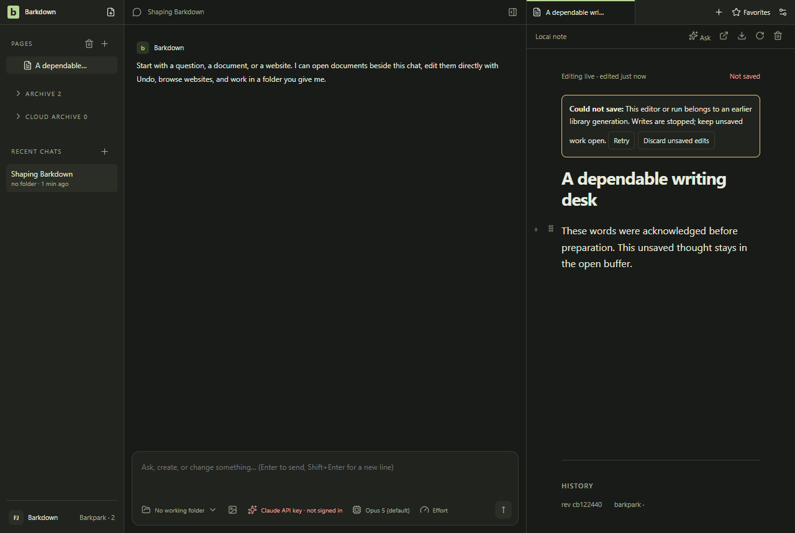
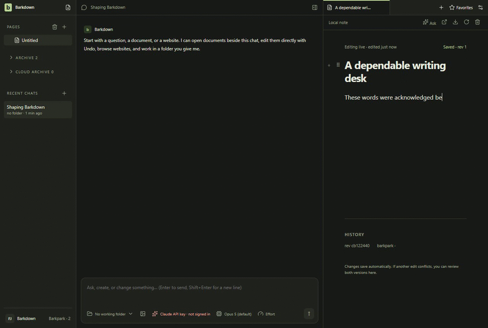

# Writer admission and migration preparation

Captured foreground, provider, MCP and goal contexts cannot silently acquire a new writer generation. Failed or interrupted mutations retain uncertain admissions; a dead process alone cannot clear them.

Disposable private Paper, dark mode: typing after quiescence remains visible with a save refusal. This is an internal test controller, not a shipped migration button.

The full-frame excerpt shows typing, refusal and the deliberate narrow resize. [Full edit recording](runs/2026-09-25T12-45-28-088Z/page@edf704b380b3c4b019cda7841c3475e3.webm), [restart recording](runs/2026-09-25T12-45-28-088Z/page@7a1b4739c1a6faff294de150372ccf7a.webm), [manifest and stills](runs/2026-09-25T12-45-28-088Z/manifest.json), [named review and encoding](runs/2026-09-25T12-45-28-088Z/review.json). Source e4a60ac9; private upstreamb70214090.

[Behavior evidence](../../cycles/evidence/C075/README.md) proves stale native/MCP/goal writes refuse, admitted asynchronous writes remain tracked, interrupted writers remain uncertain, and original/server bytes survive. The narrow pane is cramped but controls remain reachable. Restart shows readable original history and an honest refused workspace-save toast.

This does not restore a dirty buffer after abrupt restart, fence arbitrary external clients, reconcile uncertainty, select a migration authority or retire the legacy editor. Those remain A2.

## Changelog

- 2026-09-25, final C075 source e4a60ac9: refreshed and reviewed4 stills,81 raw samples at1fps and all51 excerpt frames after provider-streaming/failure fixes. Narrow wrapping and startup theme flash remain explicit limitations; no new geometry loss.

- 2026-09-25, C075: reviewed4 native stills,103 raw samples at1fps and all59 excerpt frames. The [earlier recording](runs/2026-09-25T11-40-27-781Z/REJECTED.json) remains rejected for capture scale/clipping; the corrected capture uses actual BrowserWindow geometry.
